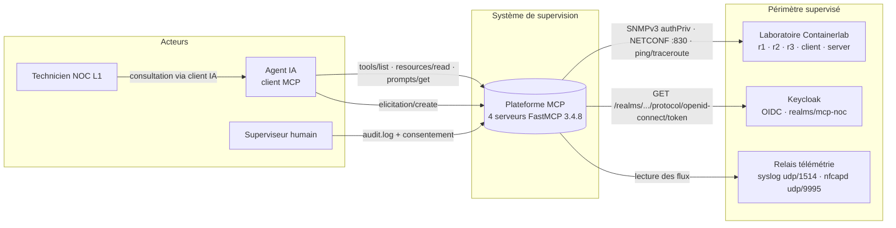
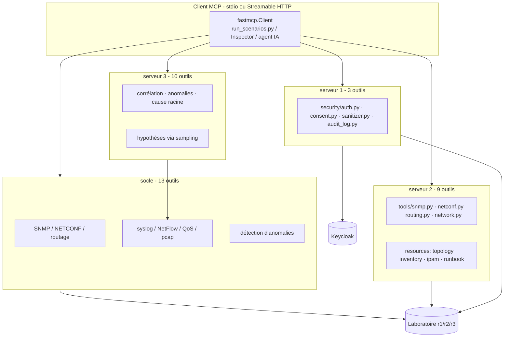
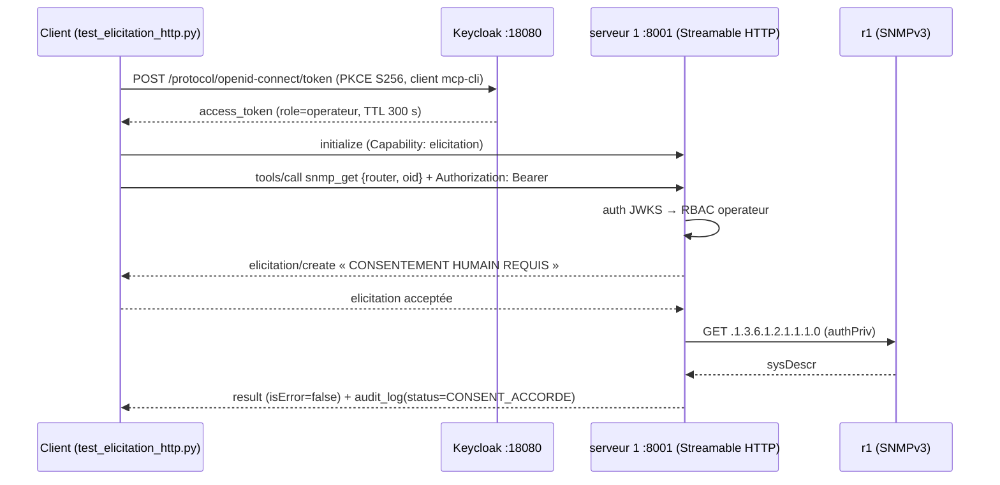

# Revue d'architecture — Application MCP pour l'analyse et la supervision des réseaux télécoms

> Document de la **Partie I** du rapport PPP. Il décrit, justifie et discute l'architecture
> **telle qu'elle est réellement implémentée** dans ce dépôt au 20 octobre 2026.
> Les chiffres cités (outils / ressources / prompts) sont ceux obtenus par `tools/list`,
`resources/list` et `prompts/list` sur des processus réellement démarrés
> (journal : `docs/campagne_scenarios.txt`), et non des intentions de conception.
>
> Référentiel : cahier des charges *PPP_MCP_Telecom_Supervision* (A.1 → B.10).
> Mise en œuvre chiffrée (Partie II) : `docs/Mise_en_oeuvre.md`.

---

## 1. Périmètre et principes directeurs

Le projet répond à une demande NOC (Network Operations Center) : permettre à un **agent
IA** de consulter un réseau, d'expliquer des anomalies et de préparer des actions, **sans
jamais pouvoir modifier le réseau de façon silencieuse**.

Principes appliqués, dans l'ordre de priorité :

| # | Principe | Traduction technique |
|---|----------|----------------------|
| 1 | **Lecture seule par défaut** | SNMPv3 en lecture, NETCONF filtré aux opérations `<get>`, routage interrogé en `show` (FRR `vtysh`), aucune écriture dans `running-config` ni `write file` |
| 2 | **Aucun secret en argument d'outil** | Credentials SNMP/NETCONF lus dans l'environnement du processus (`.env` gitignoré, `.env.example` avec placeholders) |
| 3 | **Authentification OIDC vérifiable** | Keycloak (issuer `http://localhost:18080/realms/mcp-noc`), validation JWKS côté serveur, TTL court (300 s) |
| 4 | **Consentement humain traçable** | `elicitation/create` par défaut ; chaque exécution écrite dans un journal d'audit JSONL |
| 5 | **IA confinée** | Sanitizer de prompt-injection sur les flux syslog/NetFlow, hypothèses isolées côté client, aucun outil d'écriture exposé au modèle |
| 6 | **Reproductibilité** | Laboratoire Containerlab versionné, fixtures disponibles (`COLLECTOR_MODE=fixture`), campagne de scénarios automatisée |

---

## 2. Vue C4 — niveau 1 : contexte



**Interactions critiques**

1. Le client IA ne parle jamais directement au réseau : tout passe par un serveur MCP.
2. Keycloak est le seul référent d'identité ; les rôles MCP (`operateur`, `superviseur`,
   `administrateur`) sont portés par le jeton, pas par le serveur.
3. Le laboratoire est un **réseau réel** (conteneurs FRR, SNMPv3, NETCONF), pas un mock :
   les résultats observés proviennent d'équipements virtuels qui routent réellement.

---

## 3. Vue C4 — niveau 2 : conteneurs (les 4 processus MCP)

| Conteneur (processus) | Entrée | Transport | Outils | Ressources | Prompts | Rôle |
|---|---|---|---|---|---|---|
| **socle** `mcp_server.server` (dans `PPP_MCP_Telecom_Supervision/`) | `-m mcp_server.server` | stdio | **13** | 3 | 3 | Référence A.1→B.10 : SNMP, NETCONF, ping/traceroute, BGP/OSPF, syslog, NetFlow, QoS, capture, anomalies |
| **serveur 2** `noc-mcp-server/server.py` | `python server.py` | stdio | **9** | 4 | 3 | Collecte d'état : SNMPv3, NETCONF, routage FRR, connectivité, + ressources documentaires (topologie, inventaire, IPAM, runbook) |
| **serveur 3** `mcp-noc-ai/server.py` | `python server.py` | stdio | **10** | 3 | 2 | Cerveau d'analyse : corrélation d'alarmes, détection d'anomalies, cause racine, hypothèses (via *sampling*), rapport d'incident |
| **serveur 1** `mcp-noc-telecom/server/main.py` | `-m server.main` | **stdio + Streamable HTTP :8001** | **3** | 1 | 1 | Serveur de **référence sécurité** : OIDC, RBAC, consentement, audit, sanitizer |

**Total exposé : 35 outils, 11 ressources, 9 prompts** (4 processus, tous FastMCP 3.4.8).



### 3.1 Serveur 1 — décomposition interne (composants)

```
mcp-noc-telecom/server/
├── server/config.py          # 40+ variables d'environnement, aucun secret en dur
├── server/security/
│   ├── auth.py               # OIDC JWKS, décoder/valider le jeton, extraction des rôles
│   ├── consent.py            # elicitation | terminal | dry_run | deny + état TTL 24 h
│   ├── sanitizer.py          # détection d'injection de prompt sur les flux texte
│   └── audit_log.py          # journal JSONL : user, tool, params (hachés), status, detail
├── server/tools/supervision.py   # snmp_get, snmp_get_secure, get_syslog_message
└── server/tools/demo_attack.py   # cibles volontairement piégées pour la démo A.6
```

Le **guard middleware** est le point d'entrée unique de tout appel d'outil :
`auth → RBAC → consentement → sanitizer → exécution → audit`. Aucun outil ne peut être
appelé en contournant cette chaîne (vérifié par `demo_securite.py`).

### 3.2 Serveurs 2 et 3 — garde local

`noc-mcp-server/guard.py` et `mcp-noc-ai/guard.py` appliquent une logique allégée
(mode journal + consentement simulé ou terminal) destinée au **laboratoire**. C'est le
serveur 1 qui porte le modèle de conformité A.6 ; cette répartition est assumée (ADR-04)
mais constitue un point de vigilance (§7).

### 3.3 Dépendances et indépendance réelle des serveurs

Contrôle du 20/10/2026 sur les `requirements.txt` livrés :

| Conteneur | Dépendances déclarées | Stack réseau |
|---|---|---|
| socle (`mcp_server.server`) | FastMCP 3.4.8 + collecteurs (pysnmp, ncclient, netmiko, napalm, nfdump, tshark) | complète, en-process |
| **serveur 1** (`mcp-noc-telecom`) | **`fastmcp`, `pyjwt`, `python-dotenv`** uniquement | **aucune** : `snmp_get`/`snmp_get_secure` exécutent `docker exec clab-mcp-noc-lab-client snmpwalk -v3 -l authPriv …` |
| **serveur 2** (`noc-mcp-server`) | FastMCP 3.4.8 + **environ 80 paquets épinglés** (`pysnmp`, `ncclient`, `paramiko`, `lxml`, `cryptography`, …) | complète, en-process |
| **serveur 3** (`mcp-noc-ai`) | **`fastmcp` + `pytest`** uniquement | **aucune** — pure analyse sur données déjà collectées |

Deux conséquences structurantes, vérifiées par lecture des sources :

1. **Le serveur 3 n'a aucune stack réseau.** Il ne peut raisonner que sur des données
   déjà remontées ; c'est l'argument technique le plus solide de l'ADR-07 (sécurité par
   construction : pas d'accès réseau = pas de risque d'action latérale).
2. **Le serveur 1 ne parle pas SNMP lui-même** : il délègue au conteneur `client` du
   laboratoire par `docker exec`. Son couplage n'est donc pas à une librairie mais à un
   **nom de conteneur** et au binaire `docker` (voir W10, §7.2).

Le gel complet des 80 dépendances du serveur 2 (`pinned`) est maîtrisé ; les trois
autres restent sur des bornes élastiques (`fastmcp>=3.0,<4.0`). Toutes les versions
convergent vers **FastMCP 3.4.8** (contrôle `pip show fastmcp` dans les 4 venv).

---

## 4. Vue C4 — niveau 3 : flux détaillés

### 4.1 Appel d'outil protégé (chaîne HTTP + PKCE + consentement) — prouvé en S8



**Observé le 20/10/2026** : 1 demande d'elicitation reçue, résultat SNMPv3 réel
(`Linux r1 7.0.0-38-generic …`), exit code 0.

### 4.2 Collecte d'état (serveur 2, transport stdio)

`snmp_get` / `netconf_get` / `get_ospf_neighbors` → lecture du labo → formatage →
retour au client. Chaque appel est **indépendant** : aucun état n'est conservé côté
serveur, ce qui rend les appels rejouables et idempotents (propriété nécessaire pour un
client IA).

### 4.3 Chaîne d'analyse d'incident (serveur 3) — scénario S7

```
syslog AdjChg (udp/1514) ──► analyze_netflow / get_recent_syslog (socle)
        │
        ▼
correlate_alarms ──► detect_anomalies ──► analyze_root_cause
        │                                        │
        │                                        ▼
        │                          formuler_hypothese  ← sampling (le modèle propose)
        ▼
generate_incident_report ──► rapport structuré (markdown) rendu au client
```

Le serveur 3 n'exécute **jamais** de commande réseau : il raisonne sur des données déjà
collectées par les serveurs 2 / socle. Cette séparation (collecte ≠ raisonnement) est la
garde-fou principale contre une IA qui modifierait le réseau.

### 4.4 Exploitation d'une panne (S9)

`inject_bgp_flap.sh link_down` → coupure du lien r1↔r2 → les outils continuent de
répondre pendant la panne (état dégradé réel : 1 voisin OSPF au lieu de 2) →
`link_up` → OSPF revient en `Full` (2 voisins), la route vers 3.3.3.3 repasse par
**eth1 (metric 20, chemin primaire)**, eth2 (cost 100) redevenant secours.

---

## 5. Contrats et données

| Contrat | Support | Statut |
|---|---|---|
| Schémas d'outils | `docs/schemas/{mcp-noc-socle,noc-mcp-server,mcp-noc-ai,mcp-noc-telecom}.json` (35 outils documentés) | générés depuis `tools/list` |
| Ressources documentaires | `noc://topology`, `noc://inventory`, `noc://ipam`, `noc://runbook/restart-switch` | lues en S1 |
| Journal d'audit | JSONL : `timestamp, user, tool, params, status, detail` | 98+ entrées observées |
| Résultats de campagne | `docs/scenarios_resultats.json` (29 appels, 18 outils, 18 consentements) | rejouable |
| Fixtures collecteurs | `collector/*/fixtures/*.json` | mode `COLLECTOR_MODE=fixture` |

---

## 6. Décisions d'architecture (ADR)

### ADR-01 — FastMCP 3.4.x, pas 4.x

- **Statut** : accepté (2026-10), vérifié par `pip show fastmcp` dans les 4 venv.
- **Contexte** : le cahier des charges impose l'écosystème MCP ; FastMCP offre
  `@mcp.tool/resource/prompt` + client unifié + transports stdio/HTTP.
- **Décision** : dépendance épinglée `fastmcp>=3.0,<4.0`.
- **Conséquences** : primitives A.2 (sampling, completions, roots, logging, elicitation)
  disponibles et utilisées ; la migration vers 4.x sera un chantier distinct.
- **Correction** : toute mention d'une « divergence vers 4.x » dans les rapports est
  **inexacte** et doit être retirée.

### ADR-02 — Double transport : stdio (labo) et Streamable HTTP (exposition)

- **Statut** : accepté.
- **Justification** : stdio est le transport le plus simple pour un client local
  (MCP Inspector, scripts de campagne) ; Streamable HTTP est indispensable dès que le
  client est distant ou mutualisé, et permet d'exercer la chaîne OAuth 2.1 + PKCE.
- **Conséquences** : le serveur 1 expose les deux ; les serveurs 2/3 restent en stdio
  (suffisant pour le laboratoire). Risque : exposition HTTP sans TLS sur `127.0.0.1`
  uniquement (§7).

### ADR-03 — OIDC Keycloak avec deux clients

- **Statut** : accepté.
- **Justification** : un client PKCE (`mcp-cli`, code flow + S256) pour un vrai client
  navigateur, et un client ROPC (`mcp-cli-ropc`, *direct access grants*) pour les
  scripts et l'agent sans navigateur. Sans ROPC, le scénario d'automatisation ne peut pas
  obtenir de jeton.
- **Conséquences** : le rapport doit documenter `client_id=mcp-cli-ropc` pour les
  scripts ; ROPC est à désactiver en production (contrôle 2 du §8.2).

### ADR-04 — Consentement `elicitation` par défaut, `dry_run` réservé à l'automatisation

- **Statut** : accepté, **corrigé le 20/10/2026**.
- **Contexte** : `elicitation` exige un client capable de répondre à
  `elicitation/create` ; MCP Inspector 2.9 ne le fait pas (échecs de tests GUI),
  et les `.env` de labo forçaient `CONSENT_MODE=dry_run`, ce qui **affaiblissait A.6**.
- **Décision** :
  - `.env` livré = `elicitation` (conforme A.6) ;
  - `scripts/inspector.sh` force `CONSENT_MODE=dry_run` **explicitement** pour la GUI
    (avec commentaire) ; `load_dotenv()` sans `override=True` garantit que la variable
    d'environnement l'emporte sur le fichier ;
  - les tests automatisés passent `CONSENT_MODE=dry_run` sur la ligne de commande.
- **Conséquences** : le comportement par défaut est désormais celui exigé par A.6, et la
  simulation n'existe plus qu'en dérogation explicite et tracée.

### ADR-05 — Secrets uniquement en environnement

- **Statut** : accepté.
- **Justification** : B.6 interdit les secrets en argument d'outil (visibles dans les
  journaux, les traces MCP et les historiques). FastMCP journalise les arguments.
- **Implémentation** : `.env` (gitignoré) + `.env.example` (placeholders) ; lecture par
  `os.getenv` au démarrage ; refus d'amorçage si une variable obligatoire manque.
- **Conséquences** : un déploiement neuf échoue tant que le `.env` n'est pas renseigné —
  comportement voulu (défense en profondeur), au prix d'une étape d'installation.

### ADR-06 — Lecture seule NETCONF et routage

- **Statut** : accepté.
- **Justification** : le cahier des charges autorise l'analyse et la préparation
  d'actions, pas l'application silencieuse de configurations.
- **Implémentation** : NETCONF restreint aux opérations de lecture (`<get>`) ;
  le routage est interrogé par `vtysh -c "show …"` ; la coupure de panne est faite par
  un script d'exploitation séparé (`inject_bgp_flap.sh`), **jamais** par un outil MCP.
- **Conséquences** : toute montée en puissance (écriture de configuration) exigera un
  ADR nouveau, un contrôle de change et un journal d'écriture dédié.

### ADR-07 — Décomposition en 3 serveurs spécialisés + un socle

- **Statut** : accepté, **avec réserve** (voir §7).
- **Justification** : séparer *collecte* (serveur 2), *raisonnement IA* (serveur 3) et
  *politique de sécurité* (serveur 1) limite le périmètre de compromission de chacun et
  permet des modèles de permissions distincts. Le socle unique reste la référence
  fonctionnelle (13 outils) pour la recette A.1→B.10.
- **Preuve par les dépendances** (§3.3) : le serveur 3 dépend de `fastmcp` **seul** —
  il n'a littéralement pas les moyens d'atteindre le réseau. Le serveur 1 tient en 3
  paquets et délègue l'accès réseau au conteneur `client` du laboratoire. Seul le
  serveur 2 embarque une stack réseau complète (~80 paquets).
- **Conséquences** : des noms d'outils identiques coexistent sur plusieurs processus
  (`ping_host`, `get_bgp_peers`, `detect_anomalies`) ; le client doit connaître le
  serveur cible. C'est la principale source de confusion descriptifs/implémentation.

### ADR-08 — Confinement de l'IA : sanitizer + audit + refus d'écriture

- **Statut** : accepté.
- **Justification** : les entrées texte (syslog, NetFlow, descriptions d'équipements) sont
  un vecteur d'injection de prompt.
- **Implémentation** : motifs suspects détectés et neutralisés
  (« tu es maintenant… », « nouvelles instructions : », « exécute la commande suivante »),
  refus journalisé (`ALERTE_INJECTION_NEUTRALISEE`), aucun outil d'écriture exposé.
- **Conséquences** : démontré en S8/Demo 4 (3 patterns bloqués). Limite : la détection
  est par motifs, pas sémantique (§7).

---

## 7. Observations d'architecture (constats, forces, faiblesses)

### 7.1 Forces vérifiées

| Constat | Preuve |
|---|---|
| Chaîne de sécurité complète sur le serveur 1 | `demo_securite.py` : refus RBAC, consentement, sanitizer, audit — exit 0 |
| Prouvée de bout en bout (hors navigateur) | `test_elicitation_http.py` : PKCE + elicitation réelle + SNMPv3 réel |
| Aucun secret en argument d'outil | revue des signatures d'outils + `.env` gitignoré |
| Laboratoire réel et rejouable | 13/13 collecteurs, campagne S0–S7 rejouable, script de panne idempotent |
| Réversibilité de la panne | S9 : guérison OSPF/BGP constatée (2 voisins, metric 20 via eth1) |

### 7.2 Faiblesses et risques identifiés

| # | Constat | Impact | Atténuation proposée |
|---|---|---|---|
| W1 | `.env` livré du serveur 1 était en `CONSENT_MODE=dry_run` | Affaiblissement silencieux d'A.6 dans les démos | **Corrigé** (ADR-04) ; prévoir un test de non-régression sur la valeur par défaut |
| W2 | 3 serveurs dupliquent partiellement la même surface (`ping_host`, `get_bgp_peers`, …) | Dérive entre descriptifs et implémentation ; maintenance en triple | Désigner le socle comme source unique ; générer les 3 autres à partir des mêmes modules de collecte |
| W3 | iBGP sans route-reflector : r2 ne re-advertise pas les routes iBGP à r1 | La redondance est partielle : la route du LAN serveur n'est apprise que par r3 | Documenter la topologie réelle ; si redondance complète voulue, ajouter un RR ou passer en eBGP |
| W4 | Contrôle BGP du rapport : `Established` n'apparaît pas dans `show ip bgp summary` (la colonne affiche le **nombre de préfixes**) | Faux négatif de recette | Remplacer par un test numérique sur `State/PfxRcd` (voir `docs/Mise_en_oeuvre.md` §S4) |
| W5 | Streamable HTTP servi sans TLS sur `127.0.0.1` | Acceptable en labo, inacceptable en exposition | TLS (reverse proxy) avant toute mise en service réseau |
| W6 | `NETCONF_HOSTKEY_VERIFY=false` | Empêche la détection d'homme du milieu sur 830 | `known_hosts` du labo fourni par l'installer |
| W7 | Sanitizer par motifs (regex) | Contournements possibles par reformulation | Garder l'IA sans privilèges d'écriture : le sanitizer est une couche, pas la garantie |
| W8 | Couverture inégale ressources/prompts (3/3, 4/3, 3/2, 1/1) | Expérience client hétérogène | Harmoniser la couverture minimale (≥3 ressources, ≥2 prompts) |
| W9 | Les serveurs 2/3 utilisent un `guard.py` allégé | Leur comportement n'est pas aussi strict que le serveur 1 | Migrer leur garde sur le module `security/` commun |
| W10 | Le serveur 1 accède au réseau via `docker exec clab-mcp-noc-lab-client snmpwalk …` | Couplage au **nom du conteneur** et à l'accès au socket Docker ; impossible hors machine hôte | Rendre la cible configurable (`SNMP_CLIENT_CMD`) et documenter le besoin Docker |
| W11 | ~80 dépendances épinglées côté serveur 2 vs 3 paquets ailleurs | Surface de maintenance et de supply-chain déséquilibrée | Réduire le périmètre du serveur 2 aux seules libs utiles, ou générer le freeze |
| W12 | `export_schemas.py` importe les serveurs en local : `JWT_SECRET` et secrets SNMP en valeur par défaut (avertissements à la génération) | Un export lancé hors labo publierait des schémas sans rappeler la règle des secrets | Faire échouer l'export si les secrets sont encore ceux du labo |

---

## 8. Traçage exigences → architecture

| Exigence du cahier des charges | Composant | Preuve |
|---|---|---|
| A.1 — Inventaire des primitives MCP | socle (13/3/3), s2 (9/4/3), s3 (10/3/2), s1 (3/1/1) | S0 de la campagne |
| A.2 — Sampling, completions, roots, logging, elicitation | `formuler_hypothese` (sampling), elicitation serveur 1 | campagne + S8 |
| B.3 — Interrogation SNMP | `snmp_get`, `snmp_walk`, `get_device_status` | S2 |
| B.4 — Connectivité | `ping_host`, `traceroute_host` | S3 |
| B.5 — Routage | `get_bgp_peers`, `get_ospf_neighbors` | S4 (+ panne S9) |
| B.6 — Sécurité, secrets | ADR-05, guard, RBAC, audit | S8 |
| B.7 / B.8 — Incident, corrélation, panne | serveur 3 + `inject_bgp_flap.sh` | S7, S9 |
| B.9 — Télémétrie (syslog, NetFlow, QoS) | socle + relais udp/1514, nfcapd udp/9995 | S6 |
| B.10 — Configuration (NETCONF lecture seule) | `netconf_get` (r1:830) | S5 |

---

## 9. Conclusion de la revue

L'architecture est **cohérente avec le cahier des charges** et, sur les points sensibles
(sécurité, consentement, lecture seule), **prouvée par exécution** et non par simple
assertion. Les deux corrections structurantes de cette revue sont : le retour à
`CONSENT_MODE=elicitation` par défaut (W1/ADR-04) et la clarification du rôle de chaque
serveur face à la duplication de surface (W2/ADR-07). Les risques restants sont
documentés, bornés et n'empêchent pas la recette de la Partie II.
